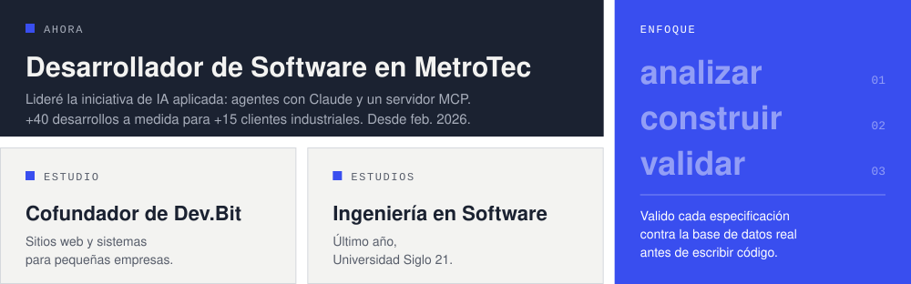

<!-- Spanish version of README.md. Assets are generated by scripts/build-assets.mjs -->

<p align="right">
  <a href="https://github.com/TillardFranco"><picture><source media="(prefers-color-scheme: dark)" srcset="./assets/lang/es-dark.svg"></picture></a>
</p>

<a href="https://francotillard.vercel.app/">
  <picture><source media="(prefers-color-scheme: dark)" srcset="./assets/hero-es-dark.svg"></picture>
</a>

<p>
  <a href="https://francotillard.vercel.app/"><picture><source media="(prefers-color-scheme: dark)" srcset="./assets/keys/portfolio-es-dark.svg"></picture></a>
  <a href="https://linkedin.com/in/tillardfrancotomas"><picture><source media="(prefers-color-scheme: dark)" srcset="./assets/keys/linkedin-es-dark.svg"></picture></a>
  <a href="mailto:tillardtomasfranco@gmail.com"><picture><source media="(prefers-color-scheme: dark)" srcset="./assets/keys/email-es-dark.svg"></picture></a>
</p>

## ~/sobre-mi

<picture><source media="(prefers-color-scheme: dark)" srcset="./assets/about-es-dark.svg"></picture>

## ~/stack

```text
stack/
├── backend/    java  spring-boot  spring-security  jwt  node  typescript  express  apis-rest
├── ia/         claude  mcp  fastmcp  agent-skills  python
├── datos/      postgresql  sql-server  mysql  prisma  jpa
├── devops/     docker  github-actions  render  vercel  sentry  git
├── frontend/   react  vite  tailwind  tanstack-query
└── erp/        totvs-protheus  advpl  tlpp
```

## ~/proyectos

<table>
  <tr>
    <td width="50%" valign="top">
      <h3><code>farmaser/</code></h3>
      <code>● en producción</code> <code>repo privado</code><br><br>
      Sistema de gestión y tienda online para una farmacia. Backend en Spring Boot 3 con ~140 endpoints REST en 29 controladores, JWT con 5 roles y cobros con Mercado Pago, con webhooks validados por firma HMAC-SHA256.<br><br>
      CI/CD con GitHub Actions: frontend en Hostinger, backend en Docker sobre Render y PostgreSQL en Neon. 4 jobs programados concilian pagos y gestionan alertas, reservas y carritos.<br><br>
      <code>java</code> <code>spring-boot</code> <code>spring-security</code> <code>jpa</code> <code>postgresql</code> <code>react</code> <code>docker</code> <code>github-actions</code><br><br>
      <a href="https://farmaciafarmaser.com.ar">→ ver sitio</a>
    </td>
    <td width="50%" valign="top">
      <h3><code>ordix/</code></h3>
      <code>○ en desarrollo</code> <code>repo privado</code><br><br>
      SaaS multi-tenant de catálogos digitales para comercios. API REST de 23 endpoints en Node/Express y TypeScript, con aislamiento por tienda en cada escritura.<br><br>
      JWT y bcrypt, helmet, CORS con allowlist, rate limiting y monitoreo con Sentry. El frontend en React 19 genera la paleta completa de cada tienda a partir de un solo color, con el contraste calculado por luminancia.<br><br>
      <code>typescript</code> <code>node</code> <code>express</code> <code>prisma</code> <code>postgresql</code> <code>react</code>
    </td>
  </tr>
  <tr>
    <td width="50%" valign="top">
      <h3><code>mcp-code-search/</code></h3>
      <code>● herramienta interna</code> <code>MetroTec</code><br><br>
      Servidor MCP en Python que expone el código de un ERP grande (10.500+ archivos, ~2,5 GB) como herramientas para asistentes de IA: buscar, leer fragmentos, explicar una rutina y mapear el impacto de un cambio, sin entregar archivos completos. Búsqueda en menos de un segundo con ripgrep.<br><br>
      Autenticación Bearer con middleware ASGI, auditoría por operación en JSONL, defensa contra path traversal y presupuesto diario por usuario.<br><br>
      <code>python</code> <code>fastmcp</code> <code>starlette</code> <code>uvicorn</code> <code>ripgrep</code>
    </td>
    <td width="50%" valign="top">
      <h3><code>ai-dev-pipeline/</code></h3>
      <code>○ experimental</code> <code>repo privado</code><br><br>
      7 Claude Skills (PM, orquestador, backend, frontend, testing, GitHub y deploy) que convierten un requerimiento escrito en un plan de tareas y lo despachan por etapas hasta abrir un pull request.<br><br>
      Los agentes se coordinan con contratos JSON validados por JSON Schema y un estado durable como única fuente de verdad. 12 scripts deterministas en Node.js recorren el grafo de tareas por oleadas, detectan ciclos con DFS y reintentan reinyectando el error, así la lógica determinista queda fuera del LLM.<br><br>
      <code>node</code> <code>claude-agent-skills</code> <code>json-schema</code> <code>git-worktree</code> <code>gh-cli</code>
    </td>
  </tr>
  <tr>
    <td width="50%" valign="top">
      <a href="https://github.com/TillardFranco/Sistema-Gestion-Backend-ERP"></a>
      <h3><code>erp-backend/</code></h3>
      Backend ERP genérico y modular construido con Spring Boot 3 y Java 17. Inventario, ventas y gestión para comercios.<br><br>
      <code>java</code> <code>spring-boot</code> <code>spring-data-jpa</code> <code>mapstruct</code> <code>mysql</code><br><br>
      <a href="https://github.com/TillardFranco/Sistema-Gestion-Backend-ERP">→ código fuente</a>
    </td>
    <td width="50%" valign="top">
      <a href="https://www.devbitsoftware.com/"></a>
      <h3><code>devbit/</code></h3>
      Sitio web del estudio de software que cofundé, con servicios, portfolio de clientes y formulario de contacto.<br><br>
      <code>react</code> <code>react-router</code> <code>tailwind</code><br><br>
      <a href="https://www.devbitsoftware.com/">→ ver sitio</a>
    </td>
  </tr>
</table>

<details>
  <summary><code>ls ~/proyectos/clientes-dev.bit</code> (4 sitios)</summary>
  <br>
  <table>
    <tr>
      <td width="50%" valign="top">
        <a href="https://airesdellagolosmolinos.com.ar"></a>
        <h4><code>aires-del-lago/</code></h4>
        Landing page para un complejo de cabañas con reservas online.<br>
        <code>react</code> <code>vite</code> <code>tailwind</code><br>
        <a href="https://airesdellagolosmolinos.com.ar">→ ver sitio</a>
      </td>
      <td width="50%" valign="top">
        <a href="https://origenoficial.com.ar"></a>
        <h4><code>origen/</code></h4>
        Tienda de ropa streetwear con catálogo, carrito y pedidos por WhatsApp.<br>
        <code>react</code> <code>vite</code> <code>javascript</code><br>
        <a href="https://origenoficial.com.ar">→ ver sitio</a>
      </td>
    </tr>
    <tr>
      <td width="50%" valign="top">
        <a href="https://anagottardi.com.ar"></a>
        <h4><code>ana-gottardi/</code></h4>
        Sitio de pastelería artesanal con catálogo, carrito de pedidos y pedidos por WhatsApp.<br>
        <code>react</code> <code>vite</code> <code>css-modules</code><br>
        <a href="https://anagottardi.com.ar">→ ver sitio</a>
      </td>
      <td width="50%" valign="top">
        <a href="https://drasavila-consultorios.ar"></a>
        <h4><code>dra-avila/</code></h4>
        Sitio para un centro médico con sistema de turnos online integrado.<br>
        <code>react</code> <code>vite</code> <code>css-modules</code><br>
        <a href="https://drasavila-consultorios.ar">→ ver sitio</a>
      </td>
    </tr>
  </table>
</details>

<br>

<picture><source media="(prefers-color-scheme: dark)" srcset="./assets/meadow-dark.svg"></picture>
