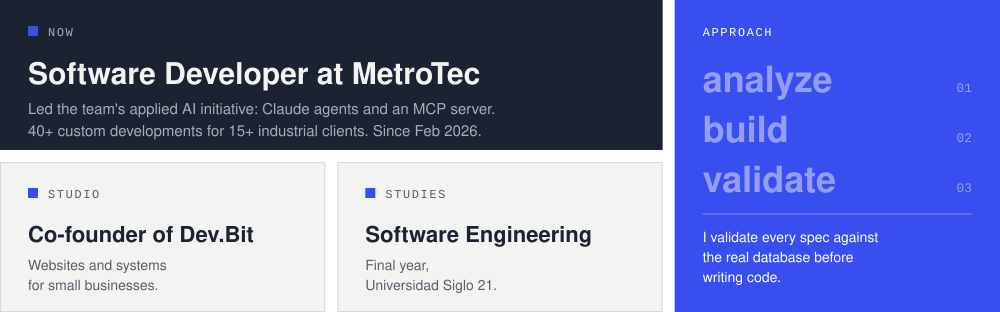
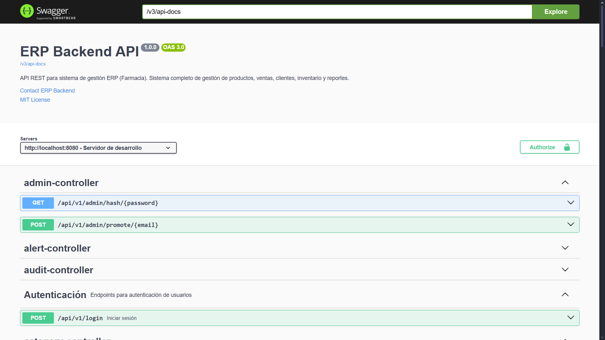
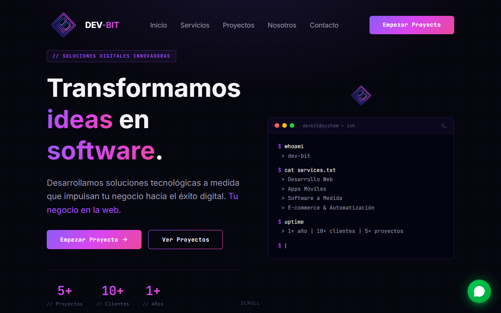
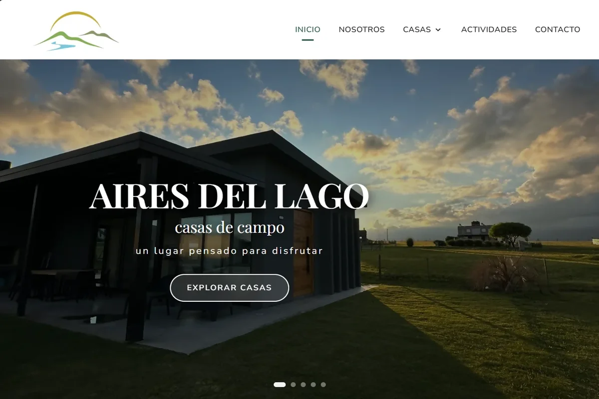
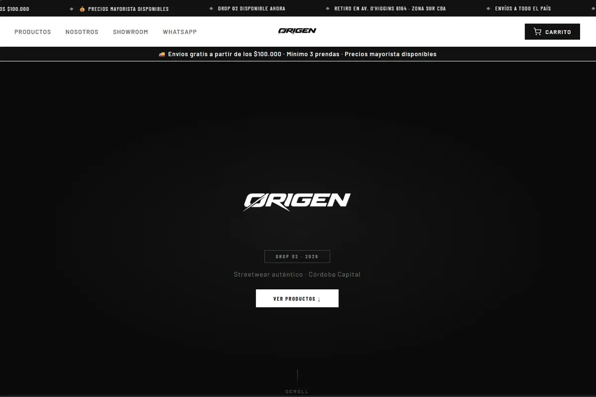
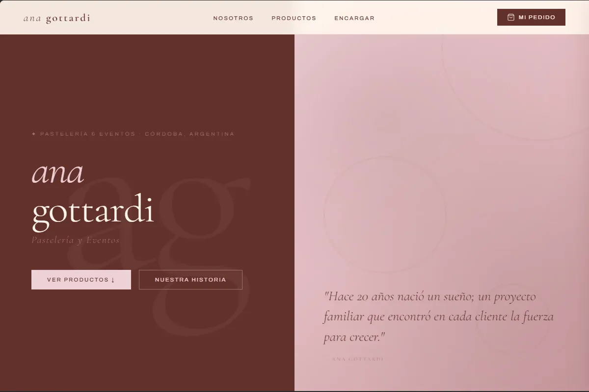
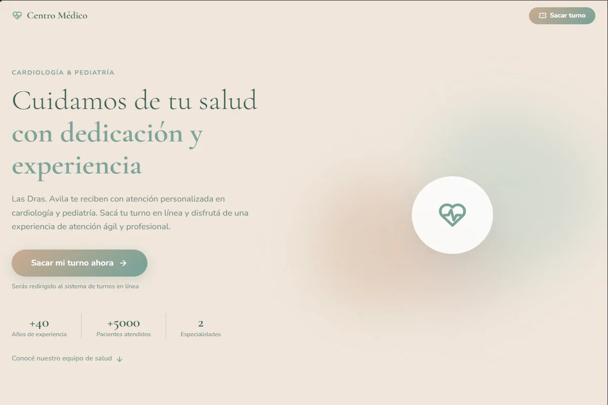

<!-- Assets are generated by scripts/build-assets.mjs -->

<p align="right">
  <a href="./README.es.md"><picture><source media="(prefers-color-scheme: dark)" srcset="./assets/lang/en-dark.svg"></picture></a>
</p>

<a href="https://francotillard.vercel.app/">
  <picture><source media="(prefers-color-scheme: dark)" srcset="./assets/hero-en-dark.svg"></picture>
</a>

<p>
  <a href="https://francotillard.vercel.app/"><picture><source media="(prefers-color-scheme: dark)" srcset="./assets/keys/portfolio-en-dark.svg"></picture></a>
  <a href="https://linkedin.com/in/tillardfrancotomas"><picture><source media="(prefers-color-scheme: dark)" srcset="./assets/keys/linkedin-en-dark.svg"></picture></a>
  <a href="mailto:tillardtomasfranco@gmail.com"><picture><source media="(prefers-color-scheme: dark)" srcset="./assets/keys/email-en-dark.svg"></picture></a>
</p>

## ~/about

<picture><source media="(prefers-color-scheme: dark)" srcset="./assets/about-en-dark.svg"></picture>

## ~/stack

```text
stack/
├── backend/    java  spring-boot  spring-security  jwt  node  typescript  express  rest-apis
├── ai/         claude  mcp  fastmcp  agent-skills  python
├── data/       postgresql  sql-server  mysql  prisma  jpa
├── devops/     docker  github-actions  render  vercel  sentry  git
├── frontend/   react  vite  tailwind  tanstack-query
└── erp/        totvs-protheus  advpl  tlpp
```

## ~/projects

<table>
  <tr>
    <td width="50%" valign="top">
      <h3><code>farmaser/</code></h3>
      <code>● in production</code> <code>private repo</code><br><br>
      Pharmacy management system and online store. Spring Boot 3 backend with ~140 REST endpoints across 29 controllers, JWT with 5 roles, and Mercado Pago payments whose webhooks are verified with HMAC-SHA256.<br><br>
      CI/CD with GitHub Actions: frontend on Hostinger, Dockerized backend on Render, PostgreSQL on Neon. 4 scheduled jobs reconcile payments and handle alerts, reservations and carts.<br><br>
      <code>java</code> <code>spring-boot</code> <code>spring-security</code> <code>jpa</code> <code>postgresql</code> <code>react</code> <code>docker</code> <code>github-actions</code><br><br>
      <a href="https://farmaciafarmaser.com.ar">→ live site</a>
    </td>
    <td width="50%" valign="top">
      <h3><code>ordix/</code></h3>
      <code>○ in development</code> <code>private repo</code><br><br>
      Multi-tenant SaaS for digital store catalogs. REST API with 23 endpoints in Node/Express and TypeScript, with per-store isolation on every write.<br><br>
      JWT and bcrypt, helmet, CORS allowlist, rate limiting and Sentry monitoring. The React 19 frontend builds each store's full palette from one brand color at runtime, with contrast computed from luminance.<br><br>
      <code>typescript</code> <code>node</code> <code>express</code> <code>prisma</code> <code>postgresql</code> <code>react</code>
    </td>
  </tr>
  <tr>
    <td width="50%" valign="top">
      <h3><code>mcp-code-search/</code></h3>
      <code>● internal tool</code> <code>MetroTec</code><br><br>
      MCP server in Python that exposes a large ERP codebase (10,500+ files, ~2.5 GB) as tools for AI assistants: search, read snippets, explain a routine and map the impact of a change, without handing over whole files. Sub-second search with ripgrep.<br><br>
      Bearer auth through ASGI middleware, per-operation JSONL audit log, path traversal defense and a daily budget per user.<br><br>
      <code>python</code> <code>fastmcp</code> <code>starlette</code> <code>uvicorn</code> <code>ripgrep</code>
    </td>
    <td width="50%" valign="top">
      <h3><code>ai-dev-pipeline/</code></h3>
      <code>○ experimental</code> <code>private repo</code><br><br>
      7 Claude Skills (PM, orchestrator, backend, frontend, testing, GitHub and deploy) that turn a written requirement into a task plan and dispatch it stage by stage until a pull request is open.<br><br>
      Agents coordinate through JSON contracts validated with JSON Schema and one durable state file. 12 deterministic Node.js scripts run the task graph in waves, detect cycles with DFS and retry by feeding the error back, so deterministic logic stays out of the LLM.<br><br>
      <code>node</code> <code>claude-agent-skills</code> <code>json-schema</code> <code>git-worktree</code> <code>gh-cli</code>
    </td>
  </tr>
  <tr>
    <td width="50%" valign="top">
      <a href="https://github.com/TillardFranco/Sistema-Gestion-Backend-ERP"></a>
      <h3><code>erp-backend/</code></h3>
      Generic, modular ERP backend built with Spring Boot 3 and Java 17. Inventory, sales and management for retail businesses.<br><br>
      <code>java</code> <code>spring-boot</code> <code>spring-data-jpa</code> <code>mapstruct</code> <code>mysql</code><br><br>
      <a href="https://github.com/TillardFranco/Sistema-Gestion-Backend-ERP">→ source code</a>
    </td>
    <td width="50%" valign="top">
      <a href="https://www.devbitsoftware.com/"></a>
      <h3><code>devbit/</code></h3>
      Website for the software studio I co-founded, with services, client portfolio and contact form.<br><br>
      <code>react</code> <code>react-router</code> <code>tailwind</code><br><br>
      <a href="https://www.devbitsoftware.com/">→ live site</a>
    </td>
  </tr>
</table>

<details>
  <summary><code>ls ~/projects/dev.bit-clients</code> (4 sites)</summary>
  <br>
  <table>
    <tr>
      <td width="50%" valign="top">
        <a href="https://airesdellagolosmolinos.com.ar"></a>
        <h4><code>aires-del-lago/</code></h4>
        Landing page for a cabin complex with online booking.<br>
        <code>react</code> <code>vite</code> <code>tailwind</code><br>
        <a href="https://airesdellagolosmolinos.com.ar">→ live site</a>
      </td>
      <td width="50%" valign="top">
        <a href="https://origenoficial.com.ar"></a>
        <h4><code>origen/</code></h4>
        Streetwear store with catalog, cart and orders through WhatsApp.<br>
        <code>react</code> <code>vite</code> <code>javascript</code><br>
        <a href="https://origenoficial.com.ar">→ live site</a>
      </td>
    </tr>
    <tr>
      <td width="50%" valign="top">
        <a href="https://anagottardi.com.ar"></a>
        <h4><code>ana-gottardi/</code></h4>
        Artisan bakery site with catalog, order cart and WhatsApp orders.<br>
        <code>react</code> <code>vite</code> <code>css-modules</code><br>
        <a href="https://anagottardi.com.ar">→ live site</a>
      </td>
      <td width="50%" valign="top">
        <a href="https://drasavila-consultorios.ar"></a>
        <h4><code>dra-avila/</code></h4>
        Medical center site with integrated online appointment booking.<br>
        <code>react</code> <code>vite</code> <code>css-modules</code><br>
        <a href="https://drasavila-consultorios.ar">→ live site</a>
      </td>
    </tr>
  </table>
</details>

<br>

<picture><source media="(prefers-color-scheme: dark)" srcset="./assets/meadow-dark.svg"></picture>
